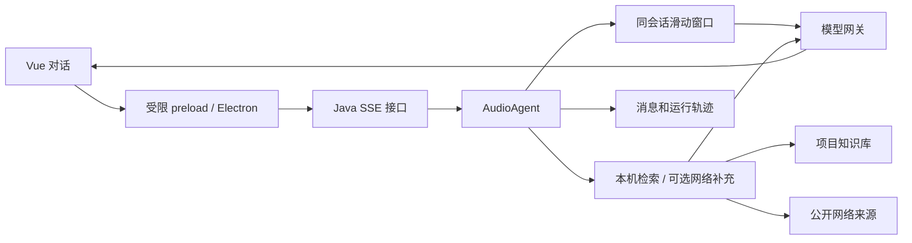

# AudioRAG 架构与技术栈

本项目按论文 Agent 的工程布局升级，复用的是分层方式与桌面技术，业务保持音频学习。

- Java 17、Spring Boot 4.1.1、JPA：API 与业务持久化。
- MySQL：用户、项目、会话消息、学习进度、资料元数据、工具轨迹与音频队列（事实来源）。
- MinIO：上传的原始资料。
- ONNX Runtime + BGE + Qdrant：本机向量生成与按项目隔离的知识库检索。
- Redis：仅缓存音频队列快照；旧队列只读兼容，不作为执行依据。
- Electron + Vue 3 + electron-vite + npm：Windows 桌面应用。
- 自写 Agent、工具接口和模型网关：未引入 Spring AI 或 LangChain。

## 包结构

```text
backend/src/main/java/com/bedouyu/audiorag/
├─ AudioRagApplication.java
├─ controller/               HTTP 接入，包含流式接口
├─ agent/audio/              音频 Agent 的业务编排
├─ core/loop/                ReAct循环、工具协议与有界上下文压缩
├─ tools/
│  ├─ audio/                 Windows TTS 与可选音频转写
│  ├─ research/              知识库检索与网络搜索
│  └─ storage/               MinIO 原稿存储
├─ ai/                       AiModelGateway 与兼容协议实现
├─ rag/                      BGE、Qdrant、自适应检索
│  ├─ index/                 共享文档/片段结构、原文坐标、版本与项目范围
│  ├─ strategy/              切片、BM25/RRF、Top-K/邻居/RSE可复用算法
│  └─ experiment/            离线真实ONNX消融实验，不加载生产服务
├─ service/                  持久队列、讲稿修改、项目与资料服务
├─ memory/                   会话原文检查点、范围校验与回合保护
│  ├─ strategy/              窗口、历史召回、原文摘记、混合组装
│  └─ experiment/            来源保留、协议回放、可选真实引用评测
├─ repository/               JPA Repository 与数据访问门面
├─ mapper/                   实体到 API 字段的转换
├─ model/
│  ├─ dto/                   请求与模型消息
│  └─ entity/                数据库实体
├─ config/                   HTTP 客户端、提示词加载
└─ common/                   异常、哈希等通用代码
```

## 一次问答



完整消息保存于 MySQL。生产聊天支持四种memory策略，默认hybrid/6000序列化JSON字符，最多扫描400条消息并核对已保存的原文摘记；新轮共享turn_id，不靠猜测配对。超长源明确摘录并可按需重读；服务端验证项目和会话归属，子Agent不自动继承会话。短追问仅参考最近非纯“继续”的用户问题。详见[Memory上下文与实验](07-Memory上下文与实验.md)。检索结果保持原来源；网络补充不会覆盖本机证据。

有模型密钥时，聊天使用原生 Function Calling 与自研 ReAct 式循环，由主控选择工具并按需委派四类专业 Agent。各 Agent 的上下文、工具权限与输出契约独立；任务共用调用预算。无密钥或关闭新运行时，仍使用原有两次检索以内的基础流程。详见 [多 Agent 运行时](03-Agent运行时与多Agent.md)。原检索工具接口 AgentTool 保留适配；新工具实现 FunctionTool，扩展专业 Agent 时实现 SpecialistAgent。

主控与研究Agent可调用knowledge_catalog，并在knowledge_search中选择dense/BM25/hybrid及Top-K/邻居/RSE rank-proxy。新版索引保留片段顺序、原文坐标和文字版本，查询组合不重复建库。旧资料明确走兼容分支，基础单节音频入口未自动替换。详见[自适应RAG与实验](05-自适应RAG与实验.md)。

提示词在 resources/prompts/audio 下，模型调用经 AiModelGateway。真实模型输出以 SSE 转发；没有模型密钥时使用本机证据摘录。断开的模型输出不会保存为一个完整轮次。

## 音频课程

学习计划先预留尚未覆盖的知识点，再检索证据、生成讲稿、调用 Windows 语音合成。生成失败会释放本次知识点，成功保存课程记录后标记完成。

连续课程以 MySQL 队列为准（Redis 仅缓存快照）：先生成完整讲稿，按规划时长分段；后台只预取有限音频片段，播放时继续补充。实际音频时长由语音速度决定，界面上的分钟数是规划值。

前端分开了项目页和工作区。工作区左侧为项目与资料，中间为资料、音频、学习进度、运行记录，右侧为会话。Electron 主进程处理本机 API、文件选择与下载；Vue 不获得任意文件路径或 Node.js 权限。

## 旧数据与升级边界

保留原表名、用户哈希协议、/api/v1 API 和数据目录。新增 agent_sessions 用于会话归属；旧会话只能在核对到当前项目的历史记录后接续。Qdrant 检索现在严格要求 project_id；旧版未绑定项目的公共向量需重新按项目入库。

首次运行时 Hibernate 按配置执行 schema update，可能新增表或调整大文本列。升级前请保留现有 MySQL 备份。此次代码验证使用独立的 H2 测试库与模拟外部服务，没有对现有 MySQL/MinIO/Qdrant 数据执行迁移或删除。

不再参与构建的旧 PWA 源码和根目录旧版构建产物已清理。音频原稿、生成的 WAV、运行配置与日志均保留，旧版架构说明仍在 legacy/HANDOVER-v1.md。后端默认端口为 18081，避免与论文 Agent 的 18080 冲突。
