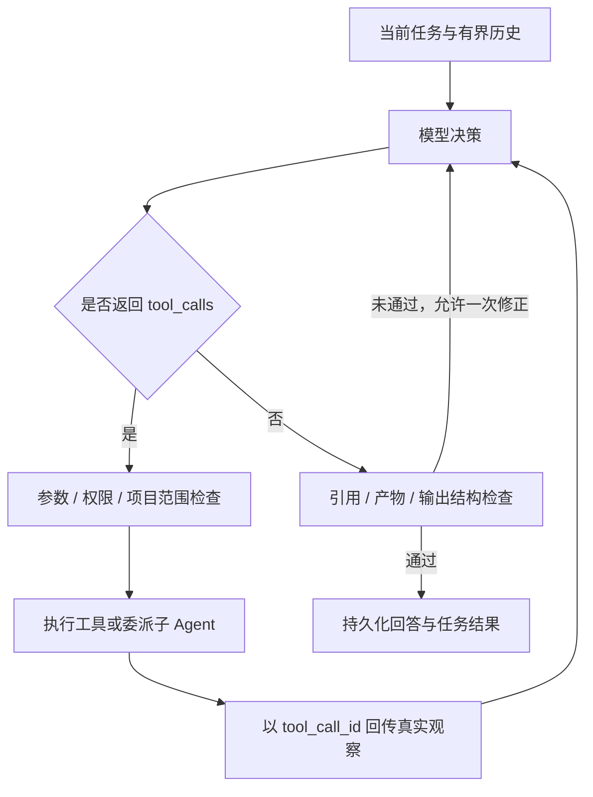

# 原生 Function Calling 与多 Agent 运行时

本轮把模型自主选择工具的运行时接入统一聊天入口。配置密钥且 AUDIORAG_AGENT_ENABLED=true 时运行原生 Agent；未配置密钥时保留基础检索演示流程。

## 运行方式

重启后端和前端，打开已有项目，在右侧输入：

> 根据本项目资料，生成一份适合初学者的 5 分钟课程讲稿，并复核内容与引用。

执行过程会显示 Agent、工具、观察与状态。“Agent 产物”页查看计划、研究报告、讲稿和复核结果。确认计划后追加真实学习知识点；确认讲稿后调用本机 TTS，并生成可播放 WAV。同一讲稿已生成音频时再次确认直接返回已有结果。

普通问题可以由主控直接检索，不要求每次经过全部专业 Agent。对明确要求生成计划、讲稿或复核的请求，完成检查会核对是否有真实产物，不能仅靠一段文字声称完成。

## Agent 分工

| Agent | 独立职责 | 可用工具 |
|---|---|---|
| supervisor | 持有会话上下文，决定检索或委派，汇总结果 | 知识库、联网、项目概况、委派、产物读取 |
| study_planner | 检查进度，生成结构化学习计划草稿 | 项目概况、产物读取 |
| research_agent | 自主改写查询、检索资料，形成带证据编号的报告 | 知识库、联网、项目概况、产物读取 |
| script_writer | 读取显式传入的资料，编写并估算讲稿篇幅 | 产物读取、时长估算 |
| review_agent | 读取讲稿和证据，执行本机检查并复核 | 产物读取、讲稿检查、知识库 |

每个子 Agent 有独立模型消息、循环次数和工具权限。主控用原生 delegate_agent 工具调用它们；子 Agent 的最终输出保存为产物，向主控返回编号和有界摘要。不会给子 Agent 隐式重放主控的全部聊天。

这一实现参考 [LangChain 官方的 Supervisor/Subagents 模式](https://docs.langchain.com/oss/python/langchain/multi-agent/subagents)，但运行时使用 Java 自研，并未集成 LangChain 或 LangGraph。

## ReAct 式循环与原生协议

网关发送工具 JSON Schema，接收原生 assistant.tool_calls，而不是让模型在普通回答里伪造动作 JSON。流式工具名称、参数与编号先聚合，只有模型完整结束的轮次才执行；多工具结果逐一与 tool_call_id 配对回灌。

模型推理与行动交替的设计参考 [ReAct 原论文](https://arxiv.org/abs/2210.03629)。执行轨迹保存公共动作、观察和校验结果，不记录私有推理内容。

DeepSeek 的工具模式要求回传本轮 reasoning_content，见 [官方协议说明](https://api-docs.deepseek.com/guides/thinking_mode/#tool-calls)。网关如收到该字段，会在本轮内完整保留并回传。公开会话历史则作为标明来源的历史数据组装，不伪装成缺少推理字段的当前 assistant 协议消息。默认关闭 thinking；可用 AUDIORAG_AGENT_THINKING_ENABLED=true 开启。

## 上下文与任务状态

- 完整公开聊天持久化到 MySQL；生产入口使用可切换MemoryContextService，而非旧Top12窗口。默认hybrid、6000序列化JSON字符，最多扫描400消息，检查点原文校验；新完成轮共享turn_id。
- 一次 Agent 上下文上限 48000 字符，单条工具观察最多约 8000 字符。
- 超预算时可用preview/structured压缩旧观察正文，后者保留状态与来源/产物指针、明确省略，保留assistant/tool配对与调用编号；必要字段无法保留时停止。
- 当前请求补充同用户、同项目、同会话最近原始任务目标、状态和产物指针，含失败或中断任务；memory_search/read与task_read可按需核对原文，不混入其他会话。
- 产物可分段读取。引用编号在任务内统一分配；读取旧产物时重映射编号并保留来源，避免两个任务的 E1 指向不同文献。
- 根任务与所有子 Agent 共用 24 次模型决策、32 次工具尝试、8 次委派和 10 分钟预算。相同 Agent 连续重复同参数超过两次会停止。子 Agent 不能递归委派。
- 模型输出长度中断、空结果、非法引用、无实际产物或必要检查缺失时，不视为正常完成。
- 服务端先用确定性规则解析本次请求的语言、目标时长（用户明确写出时才算）、篇幅与日期范围，作为一条独立提示同时注入主控和所有子 Agent；子 Agent 不继承对话记忆，但继承这条请求约束，避免主控转述遗漏或把默认 5 分钟当成用户要求。
- 篇幅按语言换算：中文约 260 字/分钟、英文约 150 词/分钟，中英双语各按一半。分段、原文朗读预算与 `estimate_duration`、`validate_script` 共用同一口径；旧实现把 260 字符/分钟套在英文上，英文讲稿的估算时长与分段长度会相差约三倍。
- 复核 Agent 需带目标时长调用 `validate_script`，估算偏差超过 25% 必须写进 issues；主控收到 `approved=false` 后要带 issues 重新委派写手修订一次再复核，而不是直接交付。
- 2026-10-22 真实 DeepSeek 实测（`tools/live-agent-check.py`，音频入口经完整多智能体链路）：4 次运行（中文、英文各 2 次）全部完成，逐条验收 8—9/9 满足、总评均为 5/5，复核覆盖率 100%。其中一次英文稿被复核判否、修订后才通过，属于回路正常工作的表现。
- 复核已改为结构化逐项检查：`checks` 必须给出 topic、genre、language、ending、length、citations、readable 七项布尔值，服务端校验「任一项为 false 时不得 approved=true」。改之前复核会批准「有标点但故事没结尾」的正文（独立验收 3/5），改之后英文稿稳定 5/5。
- 中文语速常量来自实测：用 12 段已合成 WAV 与讲稿反算得到 193 字/分钟（`tools/measure-speech-rate.py`），旧的 260 会让"3 分钟"实际播到约 4 分钟。时长只作参考，内容验收才是主指标。
- 多智能体准备失败（轮数或预算耗尽）时会退回单次生成，日志记录原因，避免用户拿不到音频；这不等于多智能体成功。

任务表保存状态与结果；产物表保存原文、输入产物编号和证据来源。重启后运行中的任务标记 INTERRUPTED，未结束的合成标记 NEEDS_REVIEW，不自动重放工具或写入。后续可基于历史记录和已保存产物继续，不是无损恢复模型的私有内部状态。

四种公开历史策略和两种工具观察压缩及实验边界见[Memory上下文与实验](07-Memory上下文与实验.md)。原文摘记不是LLM摘要，也没有跨会话用户画像；原始messages始终保留。

## 人工确认与幂等

模型没有音频合成和正式计划应用工具。写入入口在 Agent 产物页，服务端要求 confirmed=true，并验证产物归属。

2026-10-09 后进一步要求当前 `expected_content_hash`；讲稿默认需同目标/同哈希的已批准复核报告，人工覆盖需单独理由。阅读区间与检查结果按版本登记，完成判定采用最低任务规格。聊天请求幂等、固定锁顺序与中断音频人工恢复详见[可靠性升级记录](10-Agent可靠性升级记录.md)。

- 计划应用使用项目锁和知识点哈希去重，追加已有学习计划。
- 音频合成先锁定并预留状态，GENERATING 时拒绝重复调用，READY 时复用已有结果。
- 讲稿复核必须实际读取产物并执行本机检查；本机检查失败时不能返回 approved=true。
- 人工确认执行后更新产物；所有需要确认的产物处理完成，任务才由 AWAITING_CONFIRMATION 转为 SUCCEEDED。

## 验证与简历边界

自动测试使用独立 H2 数据库、真实本机 HTTP/SSE 服务和确定性测试模型。覆盖原生工具调用碎片聚合、回传编号、独立子 Agent 上下文、权限拒绝、观察压缩、跨轮引用、失败任务上下文、人工确认和幂等执行。

测试模型仅位于 src/test，不进入生产 JAR。测试通过证明协议和状态处理可运行，不能据此宣称真实大模型路由准确率或答案质量。

提供四类手动验收任务和 tools/run-agent-eval.ps1。服务和真实模型可用时，设置本机 AUDIORAG_EVAL_TOKEN，再执行脚本，记录模型次数、工具次数、委派次数、耗时和产物契约是否满足。CSV 保存到 .cache/evals，不自动合成音频或应用计划。这会调用真实模型，输出的契约通过率不等于回答正确率。

## 主要代码

- agent/audio/AgentOrchestrator：主控与子 Agent 委派。
- agent/audio/specialist：职责、工具权限、输出类型和单 Agent 上限。
- core/loop/ReActLoopEngine：模型—工具—观察循环。
- ai/NativeFunctionCallingGateway：供应商原生工具调用协议。
- tools/FunctionToolExecutor：参数、权限、项目范围与观察预算。
- core/guard/AgentOutputValidator：完成检查和有限修正。
- service/AgentRunStore、AgentArtifactStore：运行与产物持久化。
- desktop/.../AgentWorkspacePanel：产物审阅、确认与任务轨迹。
